# PharmEasy.com
## About the Project

PharmEasy.com is a web-based online medical store designed to simplify the process of browsing and ordering healthcare products. The website provides a user-friendly interface where customers can create an account, explore available products, add items to their shopping cart, and place orders.

The project also includes an administrative panel that helps manage product listings, customer information, order details, and admin accounts. PHP is used to handle the server-side functionality, while MySQL is used to store and manage application data.

Developed as a DBMS Laboratory mini-project, this application demonstrates the practical implementation of database connectivity, CRUD operations, user authentication, and the interaction between frontend and backend components.

# Technologies Used

Frontend: HTML, CSS, JavaScript

Backend: PHP

Database: MySQL

Local Development Environment: XAMPP

## Main page:
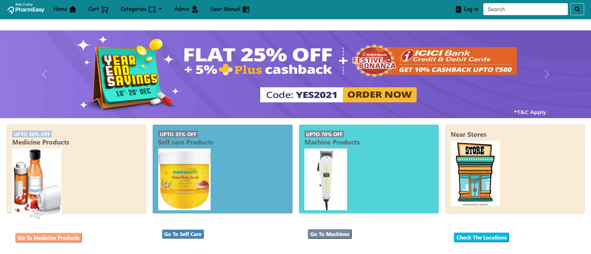
## Functionality
* ### User Login : Registered users can log in to access the website.
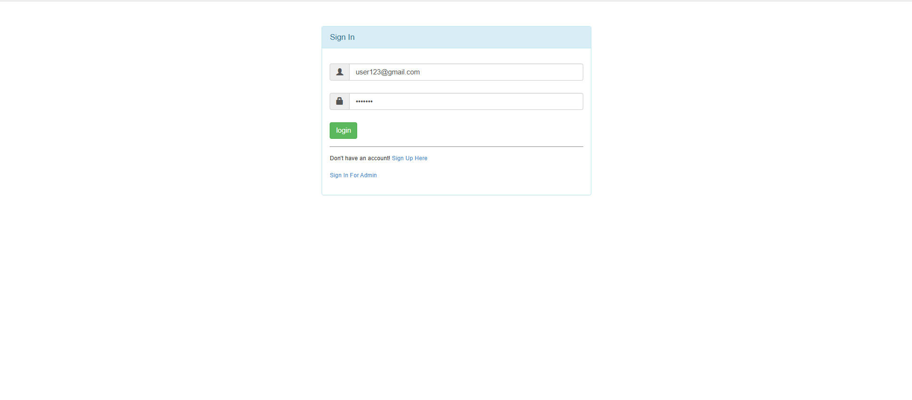
* ### User Signup : New users can create an account on the website.
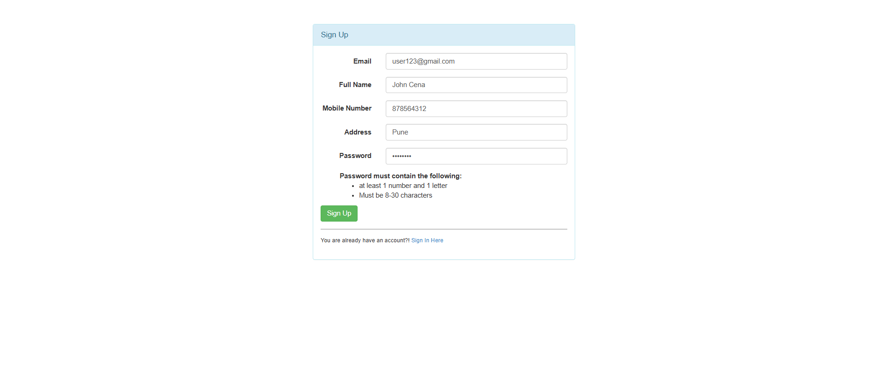
* ### Product : Users can browse products and view product details.
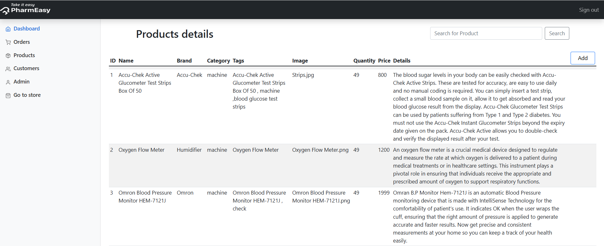
* ### Cart : Users can add products to the shopping cart before placing an order.
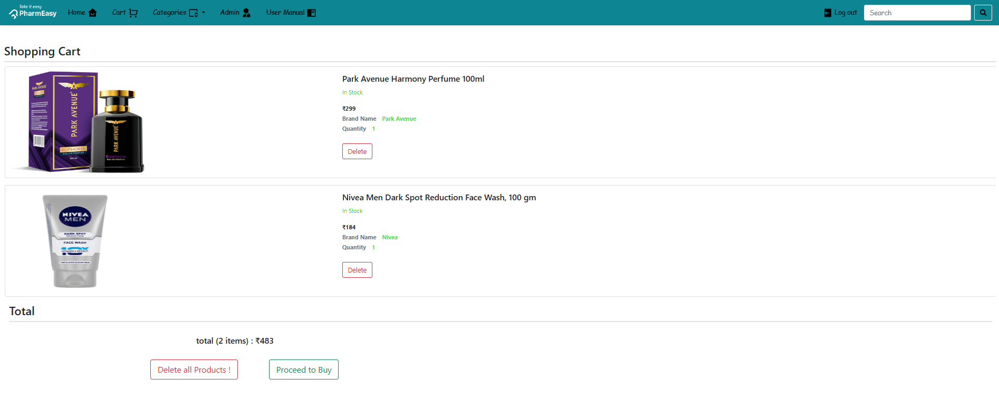
* ### Order Confirmation : Users can view the order confirmation after placing an order.
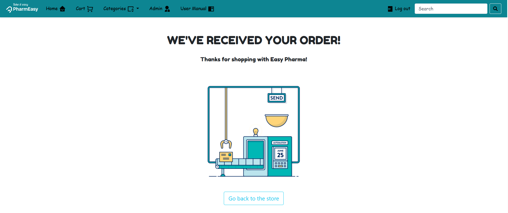
* ### Admin : The admin panel provides options to manage products, customers, orders, and admin accounts.
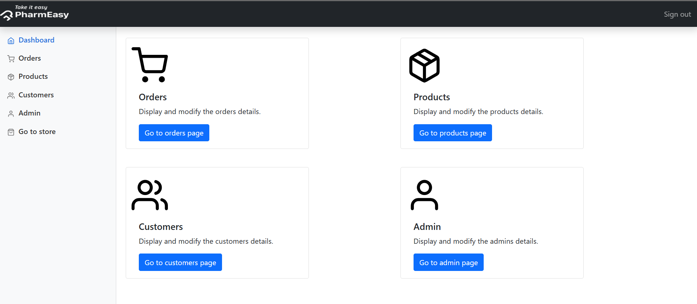
* ### Order Details and Management : Admins can view order details and manage orders.
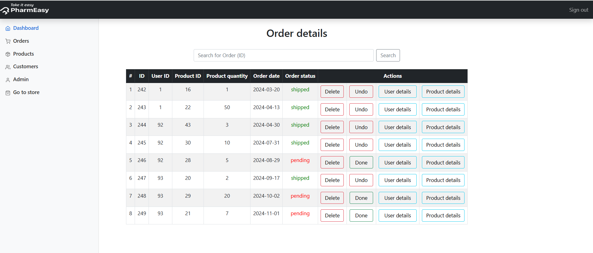
* ### Products Details : Admins can view, add, edit, and search for products.

* ### Add New Product : Admin can add the products.
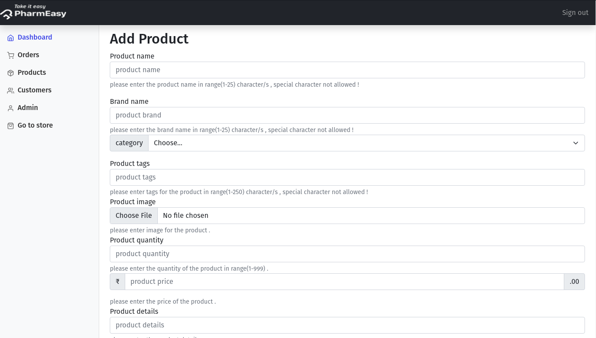
* ### Edit Product : Admin can edit the product details.
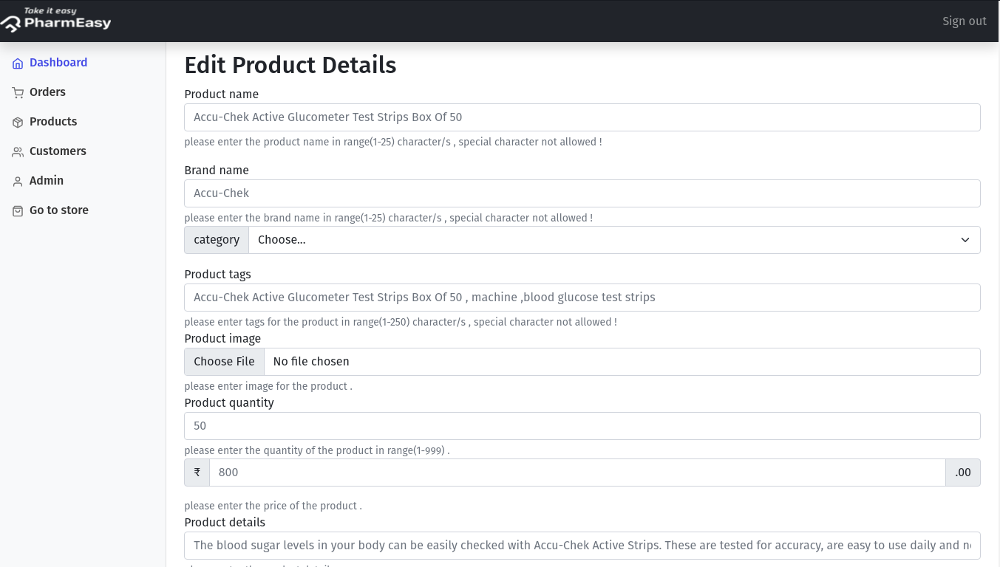
* ### Search for Product : Admin can search for products.
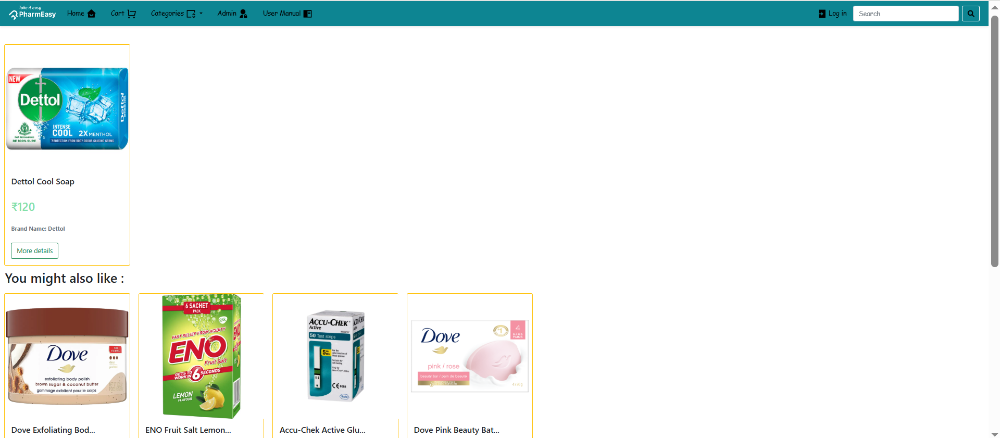
* ### Customers Details : Admin can view customer details.
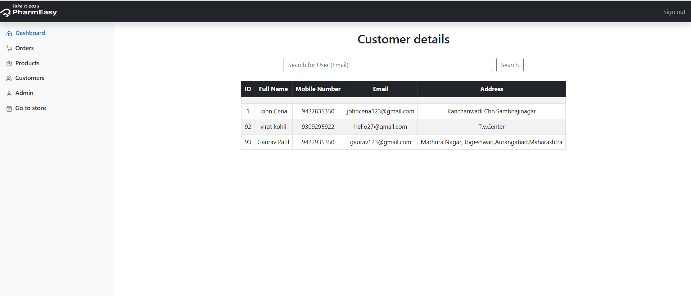
* ### Edit Customer : Admin can edit customer details.
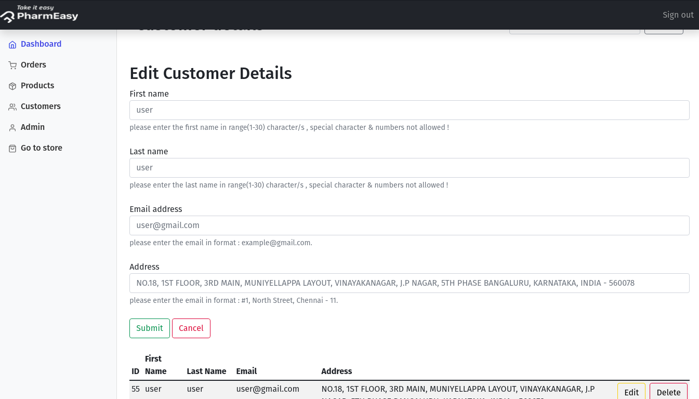
* ### Admins Details : Admin can view admin account details.
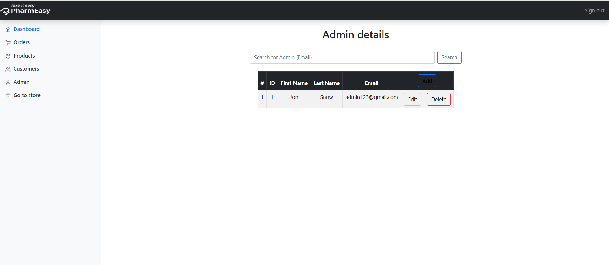
* ### Add New Admin Account : Admin can create a new admin account. 
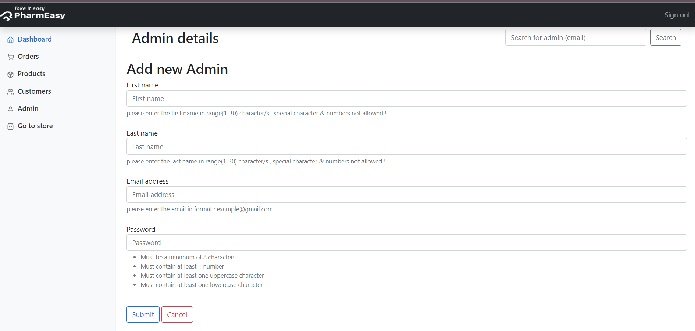
* ### Edit Admin : Admin can edit admin accounts.
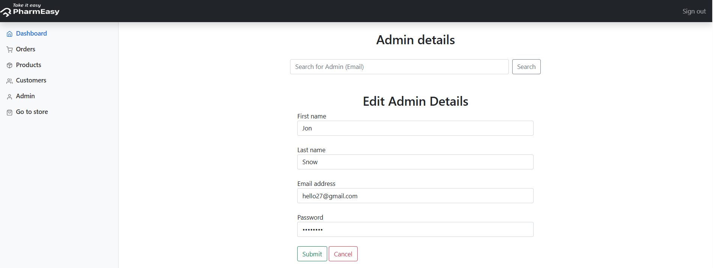
